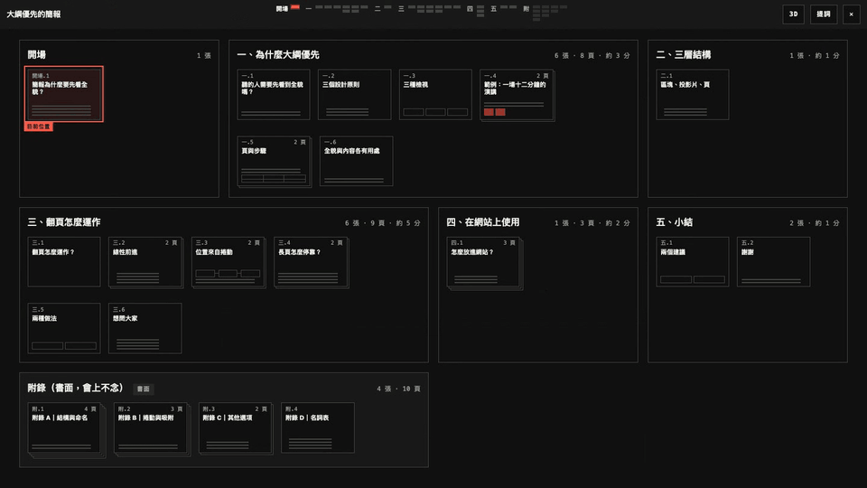
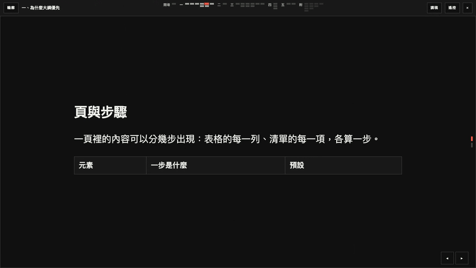
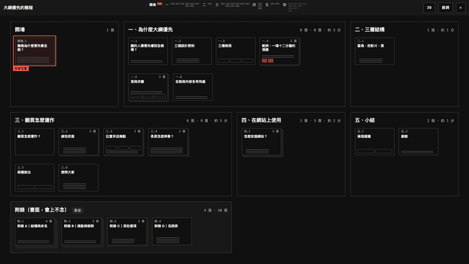
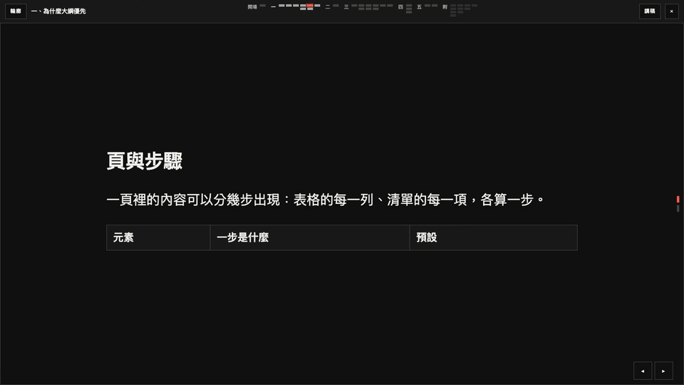
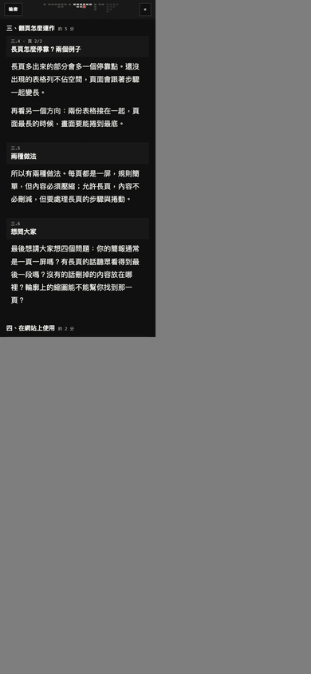
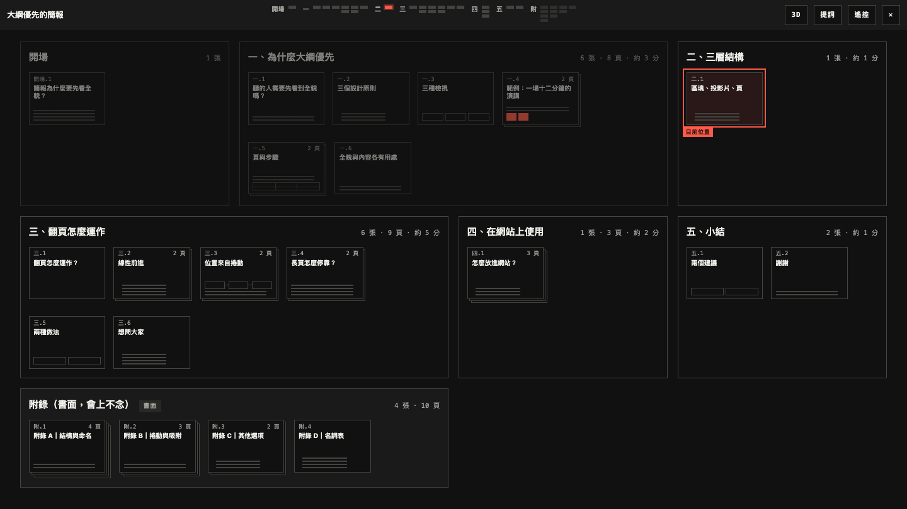
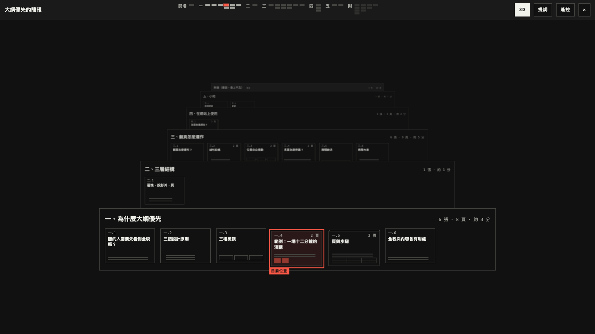
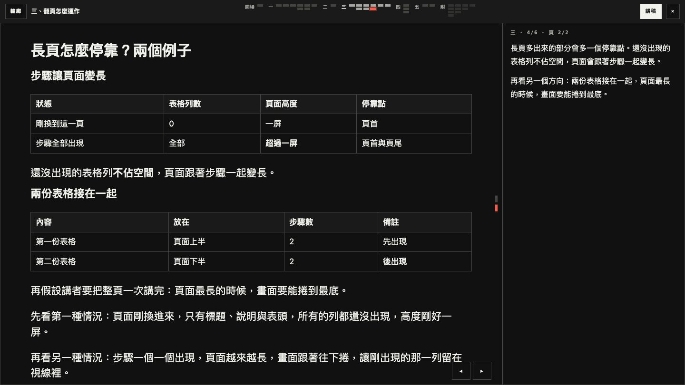
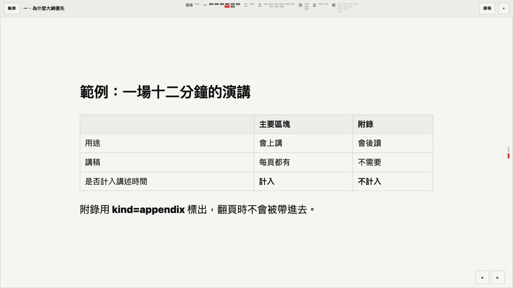

# contour-deck

<p align="center">
  <a href="https://wayne930242.github.io/contour-deck/">
    <picture>
      <source media="(prefers-color-scheme: light)" srcset="https://raw.githubusercontent.com/wayne930242/contour-deck/main/docs/media/tour-light.gif">
      
    </picture>
  </a>
</p>

Outline-first slide decks on real DOM.
A deck is blocks, slides, and pages: it opens on an outline of every block, a block opens into a left-right track of slides, and each slide scrolls down one page at a time.
The core is plain TypeScript with no runtime dependency (7 KB of JavaScript and 3 KB of CSS, gzipped); the phone remote is a separate module that loads on first use.

Status: 0.3.0 on npm. It holds the deck (M1), the M2 client (phone remote, laser pointer, drawing, tilt pointing, and a presenter window, see [Remote](#remote); the relay it talks to is a separate small service, [docs/PROTOCOL.md](docs/PROTOCOL.md)), and, new in 0.3.0, an opt-in structure for the Markdown plugins that reads blocks, slides, and pages from headings ([docs/PLUGINS.md](docs/PLUGINS.md#headings-mode)). Live demo: https://wayne930242.github.io/contour-deck/
The design is in [docs/DESIGN.md](docs/DESIGN.md) (Traditional Chinese); the HTML the core reads is in [docs/CONTRACT.md](docs/CONTRACT.md).

## 看看它怎麼動

[線上示範](https://wayne930242.github.io/contour-deck/)可以直接操作；[影片與截圖頁](https://wayne930242.github.io/contour-deck/media.html)有每一段的 mp4 與原尺寸截圖。
下面的動畫是真實的鍵盤與滑鼠操作（圓圈是滑鼠，黑底小標是按下的鍵），用 `pnpm media` 重錄。

| | |
| --- | --- |
|  |  |
| 跨區塊移動：拉遠再推進，位置列的圓點直接飛到別的區塊 | 3D 結構：按 3，頁疊成層 |
|  |  |
| 步驟：空白鍵讓表格一列一列出現 | 手機：講稿檢視與往上滑換頁 |

| | |
| --- | --- |
|  |  |
| 輪廓 | 3D 結構 |
|  |  |
| 講稿面板（按 N） | 淺色主題 |

## Use

```ts
import { createDeck } from "contour-deck";
import "contour-deck/style.css";

const root = document.querySelector<HTMLElement>("[data-ct-deck]")!;
if (new URLSearchParams(location.search).has("view")) {
  const deck = createDeck(root);
  deck.on("exit", () => deck.destroy());
}
```

Without the script the deck element is a plain document.
`createDeck` moves that same element onto a stage inside a full-window shell (`.ct-app`), and `destroy()` puts it back.
[demo/index.html](demo/index.html) is a complete host page.

### Astro

```ts
// astro.config.ts: the Markdown side, see docs/PLUGINS.md
import { remarkDeck } from "contour-deck/remark";
import { rehypeDeck } from "contour-deck/rehype";

const isDeck = file => file.data.astro?.frontmatter?.type === "slide";
// Optional. A deck with `slideOptions: { structure: headings }` in its frontmatter is read by its headings:
// `---` starts a block, `##` a slide, `###` a page. Every other deck keeps the default rules.
const structure = file => file.data.astro?.frontmatter?.slideOptions?.structure;
// remarkPlugins: [remarkDirective, [remarkDeck, { match: isDeck, structure }], …]
// rehypePlugins: […, [rehypeDeck, { match: isDeck, structure }]]
```

By default a `---` starts a slide and `::vertical` a page; [docs/PLUGINS.md](docs/PLUGINS.md) has both sets of rules.

```astro
---
import Deck from "contour-deck/astro";
const { Content } = await render(post);
---

<button data-ct-start>START</button>
<a href="?view=notes" data-ct-start="notes">Notes</a>

<Deck docClass="prose" legacy>
  <Content />
</Deck>
```

`Deck` renders a wrapper around the slot, loads the stylesheet, and starts the core: on `?view=deck` or `?view=notes`, and on a click on any `[data-ct-start]` control (`data-ct-start="notes"` opens the notes view).
It closes the deck on `exit`, gives the focus back to the control that opened it, and works under Astro's client router.

| Prop | Meaning |
| --- | --- |
| `class` | Classes of the wrapper in both views. |
| `docClass` | Classes the wrapper carries only while the deck is closed. Use it for a prose class: the open deck stays inside the wrapper, and such a class would restyle the stage and the shell. |
| `paging`, `overview` | The options of the same name below. |
| `legacy` | Accept old reveal.js links: `?view=slides&slide=h.v` opens the slide that carries that `data-legacy` index. |

A page that is not Astro gets the same behaviour from `mountAll()` in `contour-deck/host`, with the wrapper written by hand (`<div data-ct-host data-ct-doc-class="prose" data-ct-legacy>`).

### Options

| Option | Default | Meaning |
| --- | --- | --- |
| `paging` | `"snap"` | `"snap"`: one wheel or trackpad gesture moves one stop. `"free"`: native scrolling with proximity snap. |
| `overview` | `"flat"` | `"3d"` opens the outline as the tilted 3D structure. |
| `linear.skip` | `["appendix"]` | Block kinds the linear advance and the arrow keys never enter. |
| `view` | from the URL | `"deck"` or `"notes"` (the speaker notes as a scrolling script, for a phone). |
| `at` | from the URL | Entry position, such as `"4.4.2"` or a slide id. |
| `url` | `true` | Read and write `?view=` and `?at=`. |
| `labels` | Traditional Chinese | Interface text; pass the entries to replace. |
| `remote` | none | A function the remote button and the `R` key call with the deck; it usually loads `contour-deck/remote`. Without it the deck has neither. See [Remote](#remote). |

### API

```ts
deck.next();            // next step, down within the page, next page, next slide, next block
deck.prev();
deck.open("4.2");       // put a block on the stage
deck.go("4.4.2");       // or deck.go("slide-id")
deck.overview();        // back to the outline
deck.slideBy(1);        // the next slide, as the right arrow key; -1 for the one before
deck.pageBy(1);         // one stop down inside the slide, as the down arrow key
deck.state;             // { mode, block, slide, page, step }; ordinals are 1-based
deck.on("change", ({ mode, at, step }) => {});
deck.on("exit", () => deck.destroy()); // Esc on the outline, or the ✕ button of the bar
deck.on("destroy", () => {});          // once, at the start of destroy()
deck.destroy();
```

On opening, the focus moves into the shell: to the stage, to the current thumbnail of the outline, or to the notes script.

Each page receives `ct:enter` when it becomes the current page and `ct:leave` when it stops; both bubble.

### Remote

A phone controls the deck, points at it, and draws on it; a second window on the same computer shows the presenter's view.
The code is `contour-deck/remote`, loaded on first use, so a reader who never presses `R` downloads none of it.

```ts
import { createDeck } from "contour-deck";

const options = { relay: "wss://relay.example" }; // see "The relay" below
const load = () => import("contour-deck/remote");
const view = new URLSearchParams(location.search).get("view");

if (view === "remote") load().then(remote => remote.remoteView(root, options)); // the phone
else if (view === "presenter") load().then(remote => remote.presenterView(root, options)); // the presenter window
else if (view) {
  const deck = createDeck(root, { remote: deck => load().then(remote => remote.remoteHost(deck, root, options)).then(host => host.toggle()) });
  deck.on("exit", () => deck.destroy());
}
```

With Astro, `<Deck relay="wss://relay.example">` does all of this (`<Deck remote>` without a relay); so does `data-ct-relay` or `data-ct-remote` on a `[data-ct-host]` wrapper.

How to connect:

1. On the deck, press `R` (or the 遙控 button). The panel shows two QR codes.
2. Scan 手機遙控 with the phone. It opens the same page as `?view=remote&room=…` and shows a 4-digit code.
3. The deck shows the same code under 有手機要求控制. Compare the two screens and press 允許.
4. The phone now has: position and clocks (whole talk and current block, from `data-minutes`), the notes, what the next step shows, 下一步 / 上一步 / 上一張 / 下一張 / 輪廓, and three pointing tools: 紅點 (drag on a small copy of the page), 畫筆 (draw on it; a page change clears the ink), and 傾斜 (hold a button and aim the phone like a laser pointer).
5. 講稿, the other QR, is `?view=notes`: the script on the phone, turned by hand, with no connection at all.

開啟講者視窗 in the panel opens `?view=presenter` in a second window of the same browser: the current page, the next step, the notes, and the clocks. It follows over `BroadcastChannel`, needs no relay, and takes the deck's keys; the mouse over its current page is the laser pointer.

Tilt pointing reads the phone's orientation sensor (iOS asks for permission on the tap that enables it).
校正 guides through five aims: the screen's centre, then its four corners, each marked by the dot on the deck. From these the phone knows where the screen is from where you stand, and keeps it for the session.
Without calibration, the direction of the first press is the centre of a screen ±20° wide and ±12° high.
When the pointer drifts, aim at the centre and press 重新置中; aiming past an edge also drags the calibration along, as a mouse at the edge of a screen.

Security, in three lines: the relay only forwards small messages (position, commands, pointer coordinates) between the deck and at most four phones; notes, block titles, and slide content never pass through it, because the phone loads the page itself.
The room in the QR lets a phone ask; only the deck's tab holds the key the room is hashed from, so nobody else can take the deck's seat at the relay and hear what the phones send.
Control belongs to the one phone the presenter allowed on the deck after comparing the code; everything any other guest sends is ignored, and the relay removes a denied guest, so a QR photographed from the projector yields only a request to deny.

| Option of `remoteHost`, `remoteView`, `presenterView` | Default | Meaning |
| --- | --- | --- |
| `relay` | none | Base URL of the relay, `wss://…` or `https://…`. Without it the remote stays on this computer: presenter window and notes link only. |
| `qr` | built-in | `(text) => svgString`, for a site that already ships a QR library: `text => QRCode.toString(text, { type: "svg" })`. The built-in encoder takes links up to 287 bytes; a longer link shows as text. |
| `skip` | `["appendix"]` | Block kinds whose minutes are not planned time; keep it equal to `linear.skip`. |
| `labels` | Traditional Chinese | Interface text of the panel, the phone, and the presenter window. |
| `nonce` | none | Nonce for the `<style>` the module injects, for a page with a `style-src` policy. |
| `room` (views only) | `?room=` | The room to join. |

`remoteHost(deck, root, options)` resolves to the session of that deck, creating it once: `toggle()` shows or hides the panel, `end()` takes control back and closes the room, `room` is its name.
It is a promise because the room is the SHA-256 of the session's key (`crypto.subtle`, so with a relay the page needs https or localhost).
The key, the paired phone's token, and the clock live in `sessionStorage`, so a reload of the deck or of the phone continues the same session; the Astro host and the demo restart it by themselves after a reload.
With the Astro component, pass a QR encoder or labels through `configureRemote({ qr })` from `contour-deck/host`.
The remote follows the first deck of a page.

The clock starts with the first move on the stage (not when a slide is opened from the outline) and is reset from the panel.
The laser dot eases towards its target and fades when released; with `prefers-reduced-motion` it jumps and does not fade.

#### The relay

The relay is a WebSocket forwarder, one room per talk, specified in [docs/PROTOCOL.md](docs/PROTOCOL.md): rooms, the pairing messages, close codes, and limits (2 KB frames, 60 messages a second, 4 guests).
`relay(url, { room, role, key })` and `broadcast(room)` are the two `Transport`s (`send`, `subscribe`, `watch`, `reconnect`, `close`, `status`); the relay one reconnects with backoff (up to 15 s between tries, 60 s after `4004`, no host), except after `4003` (removed by the host), `4009` (another tab of the session took the host seat), and, for a guest, `4029` (room full).
The demo takes a relay from the query string, the deployed one or one on this machine: `https://wayne930242.github.io/contour-deck/?relay=wss://contour-relay.wayne930242.workers.dev&view=deck`, or `?relay=ws://localhost:8787`; it ignores any other.
The phone must be able to open the page's URL, so a deck on `localhost` needs a tunnel or the LAN address for the phone part.

### Keys

| Key | On the stage | On the outline |
| --- | --- | --- |
| `Space`, `Enter`, `PageDown` | advance one step | open the current slide |
| `Shift+Space`, `PageUp`, `Backspace` | back one step | |
| `←` `→` | previous, next slide | move between thumbnails |
| `↑` `↓` | previous, next stop | move between thumbnails |
| `Home`, `End` | first, last slide of the block | |
| `N` | notes panel | |
| `R` | remote panel (with the `remote` option) | remote panel |
| `Esc`, `O` | outline | `Esc` leaves the deck (`exit`) |
| `3` | | 3D structure |

### URL

`?view=deck&at=4.4.2` is the second page of the fourth slide of the fourth block, counted from 1.
`at` also takes the id of a slide, a page, or an element inside one.
`?view=notes` opens the notes view.
The core removes both parameters in `destroy()` and leaves the others alone.

### Theme and host styles

- Set `--ct-bg`, `--ct-fg`, `--ct-accent`, `--ct-accent-fg`, `--ct-border`, `--ct-muted`, `--ct-mono`, and `--ct-measure` on `.ct-app`.
  By default the colours follow the site's `--background`, `--foreground`, `--accent`, `--accent-foreground`, `--border`, and `--muted-foreground`.
- A page keeps its content in a centred column of `--ct-measure` through its own side padding, so margins and widths the host sets on the content stay as written.
  The type of a page follows the size of the stage and never goes below `1rem`; sizes the host writes in `em` follow it, sizes in `rem` do not.
- The open deck keeps its ancestors, so content styles that depend on them still apply.
  Document-view styles for the deck's own elements (slide cards, block headings) must stop applying when it opens: scope them to the deck's original parent with a child combinator, as `demo/demo.css` does with `.doc > [data-ct-deck] …`.
  A class that styles every descendant (a prose class) cannot be scoped that way: take it off the ancestor while the deck is open, as `Deck`'s `docClass` does.
- The shell is `position: fixed`, so no ancestor of the deck element may have a `transform`, `filter`, or `contain` that captures fixed descendants.

## Layout

```text
src/core/      the core: model, stops, gestures, navigator, outline, rail, notes, transitions, deck
src/remote/    contour-deck/remote: protocol, transports, pairing, clock, tilt math, QR, and the three views
src/remark/    Markdown directives (block, vertical, summary, build)
src/rehype/    builds the deck > block > slide > page HTML; headings.ts is the reader of `structure: "headings"`
src/astro/     Deck.astro and the host script it runs (also contour-deck/host)
styles/        index.css is the entry of contour-deck/style.css
demo/          a plain-HTML deck that follows the contract, and media.html (clips and stills)
docs/media/    GIF, mp4, and PNG made by scripts/media.mjs (not in the npm package)
tests/unit/    Vitest, tests/unit/**/*.test.ts
tests/browser/ Playwright, tests/browser/**/*.spec.ts, run against demo/; relay-stub.ts is the relay of docs/PROTOCOL.md in the test process
```

Every module under `src/` is compiled to the same path under `dist/`, so a new subpath export only needs an entry in `package.json`.
`.astro` files are copied there as they are.

## Commands

| Command | What it does |
| --- | --- |
| `pnpm install` | Install dependencies. |
| `pnpm exec playwright install chromium` | Once, for the browser tests. |
| `pnpm typecheck` | Type-check `src/`, `tests/`, and `scripts/`. |
| `pnpm build` | Compile to `dist/` and build the demo assets in `demo/assets/`. |
| `pnpm test` | Unit tests. |
| `pnpm test:browser` | Build, then run the browser tests against the demo in Chromium. |
| `CT_BROWSERS=all pnpm test:browser` | The same in Chromium, Firefox, and WebKit (`pnpm exec playwright install firefox webkit` once). |
| `pnpm size` | Minified gzip size of the core and the CSS against the budgets (12 KB, 6 KB), and of the parts of the remote. |
| `pnpm demo` | Build and serve the demo on `http://127.0.0.1:41731/demo/`. |
| `pnpm media` | Record the clips and stills in `docs/media/` (needs `ffmpeg` and Chromium); the Pages workflow publishes the mp4 and png files next to the demo. |

The demo also opens straight from the file system: `demo/index.html` after `pnpm build`.

## License

[MPL-2.0](LICENSE)
