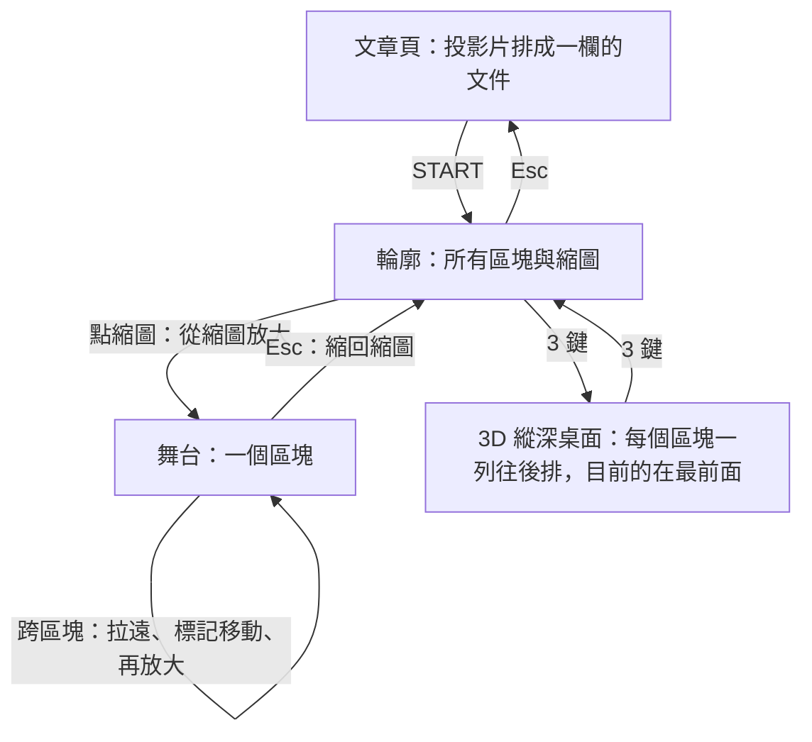
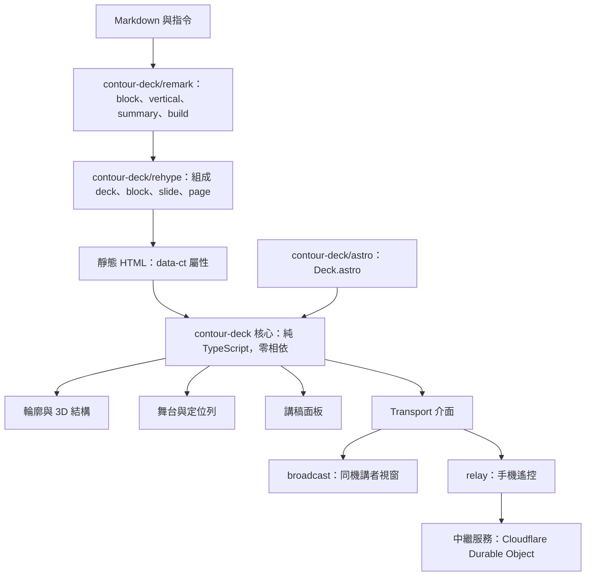
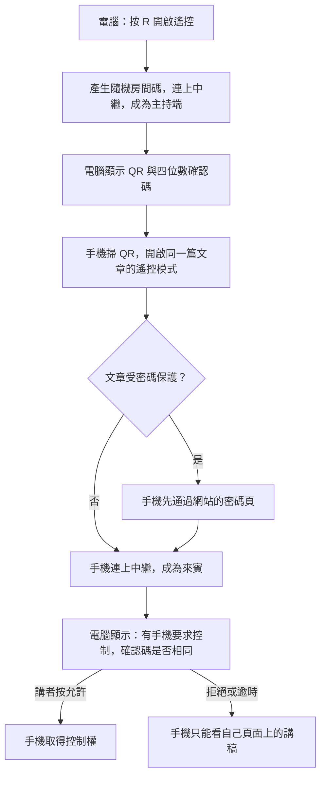

# Contour：以輪廓為入口的簡報框架（設計提案）

狀態：提案，尚未實作。原型即示範頁 [demo/index.html](../demo/index.html)，建置後用瀏覽器開啟即可（`pnpm demo`）。`Contour` 是暫定名稱。

## 結論

> [!IMPORTANT]
> 建議做成一個零相依的 TypeScript 套件 `contour-deck`：簡報的結構是「區塊 → 投影片 → 頁」三層的真實 DOM，進場先看輪廓，點開區塊後左右換張、上下換頁，位置永遠顯示在頂端的定位列。3D 用 CSS 3D transform 呈現結構，不用 WebGL。講稿在手機上看不需要後端；手機要同步並控制簡報，需要一個很小的中繼服務，建議放在 Cloudflare Durable Object。

- 輪廓、開啟區塊、左右換張、上下換頁、超過一頁的長頁、位置動畫、手機遙控的訊息格式，原型都已做出並用腳本走過一遍，結果見[原型驗證](#原型驗證)。
- 現有的 Markdown 寫法（`---`、`::vertical`、`:::summary`、`:::build`）全部保留，只新增一個 `::block` 標記區塊。兩份現有簡報不改內容也能跑。
- 已排定的近期演講建議繼續用 reveal.js。第一個可上台的版本（M1）以其後的一場演講為目標。
- 需要你決定的有六件事，在文末的表單，每件都附了我的建議。

## 要解決的問題

讀過 `blog/` 目前的實作後，問題有五個。

| 現況 | 造成的問題 |
| --- | --- |
| reveal.js 的舞台固定 1280×720，`fitSlide.ts` 把放不下的投影片字級縮到最低 55% | 表格與論證圖一多，字就小；附錄這類書面內容塞不進一張 |
| 結構只有水平與垂直兩個方向，沒有「部分」這一層 | 一場演講的五個部分只存在於每部分第一張的小標（`#### 一、為什麼大綱優先`），程式不知道，聽眾也看不到自己在整場的哪裡 |
| `overview: false`，沒有全局畫面 | 問答時要跳回某一張，只能連按方向鍵 |
| reveal.js 把內容裡的每個 `<section>` 都當成投影片 | `SlideViewer.tsx` 要複製整份 DOM，再把論證圖與資訊圖裡的 `<section>` 改寫成 `<div>`；同一份內容在頁面上存在兩份 |
| 講者模式是 reveal.js notes 外掛開的彈出視窗 | 只能在同一台電腦上用，手機看不到講稿，也不能控制 |

目前載入的體積（從 `blog/node_modules` 實測，gzip）：reveal.js 29.7 KB、reveal.css 11.6 KB、notes 外掛 19.2 KB，合計約 60 KB，另外加上 React 執行環境（`client:only="react"`）。reveal.js 目前釘在 GitHub 的某個 commit，沒有用 npm 的發行版。

## 目標與不做的事

目標依你的原話整理：

1. 進場先看全局輪廓，每張投影片有縮圖。
2. 點開一個區塊，變成左右切換的投影片。
3. 投影片高度不固定：往下一次滑一頁，移動是平滑的；單獨一頁可以比畫面長。
4. 切換時的動畫要讓人看出現在在整體的哪個位置。
5. 能用 3D 呈現結構，結構要清楚。
6. 講稿能在手機上看，手機最好能控制簡報。
7. 獨立的本機套件，之後可以發佈到 npm；blog 是第一個使用者。
8. 既有簡報不必重寫；頁面是靜態的，受密碼保護的文章也能用。

這一版不做：投影片編輯器、匯出 PPT、Prezi 那種自由擺放的畫布、聽眾端同步跟播、錄影。

## 查過的既有做法

reveal.js 與 Slidev 兩項，我今天查了官方文件；其餘依我既有的了解寫，沒有逐一重查。

| 做法 | 採用 | 避開 |
| --- | --- | --- |
| reveal.js（overview、scroll view、notes 外掛） | 水平與垂直兩個方向的空間感；scroll view 證明用捲動呈現簡報可行 | 固定尺寸再縮放；overview 只是事後縮小，不是入口，也沒有部分的標題；notes 只能同機 |
| impress.js | CSS 3D transform 就夠，內容仍是真實 DOM | 作者要手動填每一步的座標與旋轉；內容離開畫布就讀不了 |
| Prezi 這類縮放式介面 | 從全局縮放到局部，位置感最直接 | 自由運鏡容易讓人暈；空間配置和論證結構無關 |
| Slidev | `---` 分頁的 Markdown 慣例；講者畫面的內容（講稿、下一步、計時） | 遠端控制靠 `slidev --remote` 把開發伺服器開到網路上，靜態網站用不了；綁 Vue 與固定比例畫布 |
| Spectacle | 講者視窗用瀏覽器內的廣播同步，不需要伺服器 | 內容要用 React 元件寫 |
| Scrollytelling（Scrollama 一類） | 垂直捲動是瀏覽器原生行為；用 IntersectionObserver 觸發進場 | 攔截捲動改寫速度；整篇長捲動不利講者跳頁 |
| iA Presenter | 文字優先、版面隨螢幕重排，不設固定投影片尺寸 | 封閉產品，不能嵌進 blog |
| 瀏覽器原生的 scroll-snap、Web Animations、View Transitions | 換張與換頁直接交給 scroll-snap；縮放轉場用 Web Animations | View Transitions 留到之後當加強，實作前再核對各瀏覽器的支援版本 |

## 互動模型

### 三層結構

| 層 | 名稱 | 示範簡報裡的例子 | 怎麼移動 |
| --- | --- | --- | --- |
| deck | 整份簡報 | 大綱優先的簡報 | 輪廓畫面 |
| block | 區塊 | 「三、翻頁怎麼運作」（6 張，約 5 分鐘） | 從輪廓點開；區塊之間用「飛越」轉場 |
| slide | 投影片 | 「長頁怎麼停靠？」 | 左右 |
| page | 頁 | 同一張底下的「步驟讓頁面變長」「兩份表格接在一起」 | 上下，一次一頁 |
| step | 要點 | `:::build` 裡逐條出現的列 | 前進鍵 |

位置寫成 `區塊.張.頁`，例如 `三.4.2`。



### 輪廓

每個區塊是一個四邊同寬邊框的面板，標題旁列出張數、頁數與預計分鐘數。每張投影片是一個縮圖，縮圖上有編號（`三.4`）、標題，以及依內容類型畫出的示意（文字、清單、表格、並排格、流程、數字）。有多頁的投影片畫成疊起來的紙，疊幾層就是幾頁。附錄用底色與「書面」徽章區分。

講過的變淡：這一場上過舞台的投影片，縮圖的字與線往背景色靠；一個區塊的每一張都講過，區塊標題也變淡。目前那一張不變淡，由外框標出。這只是這一場的狀態，不寫進網址，重新開啟就歸零。

縮圖採示意圖而不是把真實內容縮小，理由是 7 rem 寬的縮圖上真實文字本來就讀不到，而複製 34 頁的 DOM（含資訊圖）成本高。真實縮圖列為之後的選項，見文末問題五。

### 舞台：左右換張，上下換頁

- 一個區塊是一條水平的 scroll-snap 軌道，每張投影片佔滿一個畫面寬。觸控時左右滑就是原生捲動。
- 每張投影片自己是一個垂直捲動容器，裡面的每一頁最少一個畫面高，內容多就自然變長。
- 往下的「一步」等於一個停靠點。每一頁的頂端是停靠點；比畫面長的頁，內部每 85% 畫面高再加一個停靠點，最後一個停靠點對齊頁尾。所以長頁會先在頁內往下，再到下一頁。
- 滾輪與觸控板：一次手勢移動一個停靠點，慣性尾巴忽略。觸控：用 CSS `scroll-snap-type: y mandatory` 加 `scroll-snap-stop: always`，長頁內部依規格可以自由捲動。鍵盤：`↓` `↑`。
- 右側的頁標顯示這張有幾頁、目前在哪一頁，長頁的頁標比較高，並依頁內捲動進度填色。
- 字級依舞台寬度與高度計算（`clamp(1rem, min(2.05vw, 3.7vh), 3rem)`），內容重排而不縮放，所以手機直立時版面正常。

### 一條線走完全場

`Space`、`Enter`、`PageDown`（簡報筆送的就是這個鍵）依序做：下一個要點 → 同一頁往下 → 下一頁 → 下一張 → 下一個區塊。講者上台只需要一顆鍵。方向鍵留給想自己在二維裡移動的人；`→` `←` 先顯示或收回這一頁的要點，要點走完才換張。

區塊可以標成 `appendix`。我建議線性前進走到主文最後一張就停，附錄只能從輪廓進入；示範簡報的最後一張正是「往下是書面補充，會上不念」。原型目前會直接走進附錄，這一點列在文末問題六。

### 位置動畫

位置由三個機制呈現。

| 機制 | 何時出現 | 做法 |
| --- | --- | --- |
| 定位列 | 一直在頂端 | 整份簡報的縮小地圖：每張一欄、每頁一格，目前位置的標記在格子之間滑動；點任何一格可以直接跳過去 |
| 開啟與收合 | 輪廓與舞台之間 | 舞台從該張縮圖的位置與大小放大到全畫面（FLIP），輪廓同時以該縮圖為中心放大淡出；收合反向 |
| 飛越 | 跨區塊 | 舞台縮回舊區塊的縮圖，輪廓露出，外框標記移到新區塊的縮圖，再從那裡放大。約 1.2 秒，聽眾看得到自己從哪個部分到哪個部分。3D 開著時，中段改成鏡頭往前推到新區塊那一列：講完的那一列往觀眾方向滑出，下一列推到面前 |

同一區塊內左右換張只用原生捲動，定位列的標記跟著移動，不另外加動畫，因為這個動作最頻繁。

### 3D 怎麼用，何時不用

3D 只拿透視來用：近的大、遠的小，所以「目前這一塊看得清楚」和「整份都在畫面裡」可以同時做到，平面輪廓做不到（區塊一多就要捲）。按 `3` 或 3D 按鈕，輪廓變成縱深桌面：

- 每個區塊是一列，全部面向觀眾，沿縱深往後排。目前的區塊在最前面，原尺寸、不旋轉，字清楚；後面的區塊依序退遠、變小、往上錯開，顏色往背景色靠，所以整份簡報永遠在一個畫面裡，不用捲。講過的區塊往觀眾方向滑出並淡掉。
- 只有最前面那一列的多頁投影片沿 Z 軸疊出厚度，其餘維持平面的錯位紙疊。
- `↑` `↓`、滾輪（一次手勢一列）、觸控上下滑（原生捲動，每列一個吸附點）、`Home` `End`、Tab 與點後面的列，都只把那一列推到面前，不開啟。點最前面那一列的縮圖才開啟；`←` `→` 照原本的線性順序在縮圖間移動，跨到別列時那一列推到面前。
- 3D 開著時跨區塊，飛越的中段是鏡頭往前推一列；平面輪廓的飛越不變。
- 這仍是同一批 DOM：`.ct-ov` 是捲動容器，捲動位置就是鏡頭；`.ct-desk` 是黏在畫面上、帶透視的鏡頭，`.ct-plane` 是裡面的場景。每一列的位置由 CSS 依 `--i`（第幾列）與 `--ct-cam`（鏡頭在第幾列）算出，JS 每個 frame 只寫 `--ct-cam`。霧化用 `color-mix`，不用 `opacity` 與 `filter`，因為兩者會壓平該列的 3D。列的縱深間距與上移量是 `--ct-row-depth` 與 `--ct-row-rise`。
- 一列高過畫面六成時，整列等比縮小（窄螢幕上很長的區塊）。

舊的傾斜視圖（整個平面 `rotateX`、`rotateZ`）已移除：它只多表達頁數，字又斜又小，而且量過才知道它其實沒有透視。

不用 3D 的地方：

- 閱讀投影片內容時。文字一律平面、不縮放、不旋轉。
- 使用者設定 `prefers-reduced-motion` 時。3D 視圖仍可切換，但沒有過場；所有縮放轉場改成 140 毫秒的淡入淡出，平滑捲動改成直接到位。
- 列印。

「3D 樣態」我讀成「簡報結構的立體呈現」。如果你指的是投影片裡要放 3D 模型，那屬於內容：投影片裡可以放任何 `<canvas>`，框架提供進場與離場事件讓它暫停或重播。兩種都支援，但請在問題三確認我讀對了。

## 內容模型

### Markdown 到輪廓樹

現有寫法都保留，語意微調一處，新增一個標記。

| 寫法 | 現在（reveal.js） | Contour |
| --- | --- | --- |
| `---` | 新的水平投影片 | 新的投影片（不變） |
| `::vertical` | 垂直堆疊裡的子投影片 | 同一張投影片的下一頁 |
| `:::summary` | 該張的講稿（`aside.notes`） | 該頁的講稿（不變） |
| `:::build` | 子項變成 fragment | 子項變成要點（step），拆法照舊：清單項、表格列、其他區塊 |
| `::block{title="三、翻頁怎麼運作" minutes=5}`（新增） | 無 | 從這裡開始一個新區塊；可加 `kind=appendix` |
| 閱讀時間 `data-autoslide` | 每張與每個 fragment | 每頁與每個要點，算式照舊 |
| `--i` 進場順序 | `.present` 時播放 | 該頁進入畫面時播放（IntersectionObserver） |
| 相鄰兩張同標題的 auto-animate | 標題不動、內文換 | 同一張裡相鄰兩頁同標題時，標題固定在上方（之後再做，M1 先照原樣重複） |
| `:::grid`、`:::flow`、資訊圖、論證圖、`:icon` | 放在投影片內 | 不變；它們是頁裡的一般 HTML |
| `slideOptions.transition` | reveal.js 的轉場名稱 | 忽略；新增 `slideOptions.engine`，過渡期用來選引擎 |

沒有寫 `::block` 的舊簡報，用一條後備規則：以小標（`####`）開頭的投影片開始一個新區塊，小標文字就是區塊標題。已經這樣寫的舊簡報（例如測試用的 `kicker-deck.md`），不改內容就會得到開場、「一」「二」與兩個附錄，共五個區塊。兩種都沒有的簡報（例如 `slide-templates-demo.mdx`）整份算一個區塊，輪廓顯示成一排縮圖。

### 輸出的 HTML

建置時產生的結構如下，框架只認 `data-ct-*` 屬性，不看標籤名稱，所以內容裡的 `<section>` 不再需要改寫。

```html
<div data-ct-deck>
  <section data-ct-block data-title="三、翻頁怎麼運作" data-minutes="5">
    <section data-ct-slide id="s-3-4" data-title="長頁怎麼停靠？" data-legacy="12">
      <section data-ct-page data-ms="9800">
        …內容…
        <aside data-ct-notes>…講稿…</aside>
      </section>
      <section data-ct-page>…</section>
    </section>
  </section>
</div>
```

沒有 JavaScript 時，這就是一篇照順序排列的文件，也就是現在文章頁「投影片卡片」的樣子。進入簡報時，同一批節點切換成簡報版面，不再複製一份。

### 遷移路徑

1. blog 加入 `contour-deck` 的 remark 與 rehype 外掛，與現有 `rehype-slides.ts` 並存。
2. `slideOptions.engine: contour` 的文章改走新版面；沒寫的照舊用 reveal.js。
3. 先搬一份用小標分區的簡報與範例簡報，確認資訊圖、論證圖、引文對照在頁內正常。
4. 舊連結 `?view=slides&slide=h.v` 由每張投影片的 `data-legacy`（建置時寫入的舊水平索引）對應到新位置。
5. 全部搬完後，移除 reveal.js、`SlideViewer.tsx`、`SummaryPanel.tsx` 與 `rehype-slides.ts`。

## 架構



### 核心、Astro 接頭、React

- 核心與框架無關：吃一個已經渲染好的 DOM 根節點，回傳一個控制物件。狀態只有模式與位置，捲動位置是唯一的事實來源（原型就是這樣做）。
- Astro 接頭只有三樣：remark 外掛、rehype 外掛、一個 `Deck.astro` 元件（輸出外框並用一般 `<script>` 啟動核心）。
- React 包裝不做。核心是一般函式，在 React 裡用 ref 呼叫即可；blog 的簡報頁因此不再需要 React。

先做成一個套件，用子路徑匯出（`contour-deck`、`/style.css`、`/remark`、`/rehype`、`/astro`、`/remote`）。等有第二個使用者再考慮拆成多個套件。

### CSS 3D 還是 WebGL

| | CSS 3D transform | WebGL（three.js 一類） |
| --- | --- | --- |
| 內容 | 仍是真實 DOM：文字可選、連結可點、KaTeX 與 SVG 資訊圖照常、螢幕閱讀器讀得到 | 內容要先轉成貼圖，中文字體、連結與無障礙都會失去；或用 CSS3DRenderer，那其實還是 CSS 3D |
| 主題 | 直接吃網站的 CSS 變數，深淺色不用另外處理 | 要把色票同步進場景 |
| 能做到的效果 | 傾斜、疊層、縮放、位移 | 另外還有燈光、景深、粒子、自由運鏡 |
| 體積 | 0 | three.js 核心就比整個框架的預算大十倍以上（確切數字依匯入範圍，實作前再量） |
| 風險 | 旋轉中的文字會略糊；`overflow` 與 `filter` 會壓平 `preserve-3d`，版面要避開 | GPU 與電量；context 遺失要處理；投影機電腦的顯示卡不一定好 |

我選 CSS 3D。這個框架要呈現結構，而呈現結構只需要透視、位移與疊層；而投影片內容全是 HTML，一進 WebGL 就失去文字的品質與可及性。WebGL 留給內容：某一張要放 3D 模型，就在那一頁放 `<canvas>`。

## 講稿、講者模式與手機遙控

### 講稿出現在哪裡

| 位置 | 給誰 | 需要後端 |
| --- | --- | --- |
| 簡報旁的講稿面板（`N`） | 排練，或自己閱讀 | 否 |
| 同一台電腦的講者視窗（第二螢幕） | 有延伸螢幕時 | 否，用 BroadcastChannel |
| 手機，獨立翻頁 | 上台時拿在手上當提詞機，自己滑 | 否，手機開同一個網址的講稿模式 |
| 手機，與電腦同步並可控制 | 上台時當遙控器 | 是，需要中繼服務 |

手機畫面的內容：連線狀態、已用時間與總時間、目前位置（`三 · 4/6 · 頁 2/2 · 要點 1/4`）、大字講稿、下一步會發生什麼（下一個要點、同一頁往下、下一張的標題）、大顆的「下一步」、上一步、上一張、下一張、輪廓。切到輪廓時，講稿區換成區塊清單，點一個就開啟那個區塊。螢幕保持喚醒。

時間預算來自 `::block` 的 `minutes`，所以手機可以顯示全場 12:00，之後也能顯示這個區塊已用多久。

### 可以嗎？

可以，分兩個層次。

- 手機看講稿：不需要後端。講稿本來就在簡報的 HTML 裡，手機開同一頁的講稿模式就有。
- 手機與電腦同步並控制：靜態網站自己沒辦法讓兩台裝置互相找到，必須有一個雙方都連得上的中繼點。這個中繼點很小，只轉送位置與指令。

### 傳輸方式評估

| 方式 | 跨裝置 | 需要的後端 | 會場網路的風險 | 評估 |
| --- | --- | --- | --- | --- |
| BroadcastChannel | 否，只限同一個瀏覽器 | 無 | 無 | 用在同機的講者視窗 |
| QR 配對加 WebRTC | 是 | 仍需要交換連線資訊的訊號通道；跨 NAT 需要 STUN，會場 Wi-Fi 隔離用戶端時還需要 TURN 中繼伺服器 | 高：在家能用、到會場失敗 | 不採用。名義上點對點，實際上還是要伺服器，而且失敗的時機最糟 |
| Vercel Function 當中繼 | 是 | Function 加上一個共用儲存（Redis 一類） | 低 | 可行但零件多。我查到的資料說 Vercel Functions 已支援 WebSocket，連線會固定在單一執行個體，Hobby 方案最長 300 秒；兩台裝置可能落在不同個體，所以還要一個共用的 pub/sub，並且每五分鐘重連。這幾點只查了一輪，實作前要用官方文件與實測確認 |
| Cloudflare Durable Object 當中繼 | 是 | 一個 Worker 加一個 Durable Object | 低 | 建議。一個房間就是一個物件，兩台裝置連到同一個物件，不需要另外的儲存；我查到免費方案可用 SQLite 型的 Durable Object，並支援 WebSocket 休眠。你已經在用 Cloudflare（R2、wrangler 已登入） |
| 代管的即時服務（Ably、Pusher 一類） | 是 | 第三方帳號，通常還要一個簽發 token 的 Function | 低 | 程式最少，但把特定廠商寫進要發佈的套件不合適 |

做法：核心定義一個 `Transport` 介面（送出、訂閱、關閉），內建 `broadcast` 與 `relay` 兩個實作，套件另附一份 Cloudflare 中繼的參考實作。之後想改放 Vercel 或換成代管服務，只要換一個 Transport。

### 配對與信任



- 誰能控制：持有房間碼，並且被講者在電腦上允許的那一支手機。預設只允許一支。
- 靜態頁面無法驗證身分，所以信任建立在「拿到房間碼」加「講者當場允許」。QR 如果被投影出去，觀眾掃了也只會讓電腦跳出一次要求，講者不允許就沒有作用。
- 中繼只轉送位置與指令，例如 `{b:3,s:3,p:1,step:1}` 與 `next`。講稿與內容不經過中繼，因為手機自己載入了同一頁；受保護文章的內容不會外流到中繼。
- 來賓的訊息只送給主持端，由主持端決定要不要執行；房間在主持端離線後關閉，並設存活時間與頻率上限。
- 房間碼放在網址的查詢字串。放在 `#` 之後比較隱密，但 blog 的密碼頁登入後會轉址，`#` 之後的內容會掉。
- 網路斷線時，手機仍顯示講稿，講者自己滑；電腦用鍵盤或簡報筆。簡報本身不依賴中繼。

原型裡的「遙控」按鈕開的是同一台電腦上的第二個視窗，用 BroadcastChannel 與 postMessage 模擬；訊息格式與之後走中繼的相同，並帶一個 session 代碼，只有同一場的視窗會互相回應。QR、中繼與允許步驟沒有做。

## 其他行為

### 自動播放

沿用現在的閱讀時間算式，照線性順序走，任何手動操作就暫停，走到主文結尾停止，不進附錄。

### 鍵盤與觸控

| 動作 | 鍵盤 | 觸控 | 手機遙控 |
| --- | --- | --- | --- |
| 前進一步 | `Space`、`Enter`、`PageDown` | 右下角按鈕 | 下一步 |
| 後退一步 | `Shift+Space`、`PageUp`、`Backspace` | 右下角按鈕 | 上一步 |
| 上一張、下一張（先走完要點） | `←` `→` | 左右滑 | 上一張、下一張 |
| 上一頁、下一頁 | `↑` `↓` | 上下滑 | 無（用下一步） |
| 回輪廓 | `Esc`、`O` | 輪廓按鈕 | 輪廓 |
| 3D 縱深桌面 | `3` | 3D 按鈕 | 無 |
| 縱深桌面上換列 | `↑` `↓`、`Home` `End` | 上下滑、點後面的列 | 無 |
| 講稿 | `N` | 講稿按鈕 | 一直顯示 |
| 區塊第一張、最後一張 | `Home` `End` | 點定位列 | 區塊清單 |

### 網址

`?view=deck&at=3.4.2` 表示第三區塊第四張第二頁；沒有 `at` 就停在輪廓。位置放在查詢字串而不是 `#`，理由同上：受保護文章登入後 `#` 會掉。投影片有自訂 id 時可以寫 `at=tradeoff`。原型為了能直接開檔案，暫時用 `#3.4.2`。

### 列印與 PDF

列印時輸出講義：一份連續的文件，區塊標題、投影片編號、所有要點全部展開，可選擇附講稿。投影片不再是固定尺寸，所以固定 16:9、一頁一張的 PDF 這一版不做，見問題四。

### 無障礙

- 內容是真實 DOM，標題層級與閱讀順序就是文件順序。
- 輪廓是一組有完整標籤的按鈕（「三、翻頁怎麼運作，第 4 張：長頁怎麼停靠？，2 頁」）；不在畫面上的那一層設為 `inert`。
- 開啟與收合時移動焦點：開啟後到舞台，回輪廓後回到原本那張縮圖。
- 位置改變時用 `aria-live` 念出位置。
- `prefers-reduced-motion` 的處理見上面「3D 怎麼用」一節；原型已實作並驗過。
- 滾輪一次一頁會改變滾輪的原生行為，所以提供 `paging: "free"`，改成原生捲動加鄰近吸附。

### 手機

讀者用手機看簡報時是同一個模型：輪廓變成單欄，定位列縮成小格，內容依寬度重排，講稿面板在下方。這取代了現在直立時把舞台換成 720×1280 的做法。

## 套件結構與 API

```
contour-deck/
  src/core/        model、navigator、stage、overview、rail、notes、gestures、transitions、autoplay、sync
  src/remote/      手機遙控畫面與 relay transport
  src/remark/      block、vertical、summary、build 指令
  src/rehype/      組出 deck、block、slide、page，寫入閱讀時間與舊索引
  src/astro/       Deck.astro
  relay/cloudflare/  Worker 與 Durable Object 的參考實作
  styles/          base.css、deck.css、print.css
  demo/            純 HTML 的示範簡報
  tests/           單元測試與瀏覽器端的導覽測試
```

```ts
import { createDeck, broadcast } from "contour-deck";
import "contour-deck/style.css";

const deck = createDeck(document.querySelector("[data-ct-deck]")!, {
  paging: "snap",              // "snap" 一次一頁；"free" 原生捲動
  overview: "flat",            // 進場時的輪廓："flat" 或 "3d"
  linear: { skip: ["appendix"] },
  transport: broadcast(),      // 或 relay("wss://…/room")
});

deck.overview();               // 回輪廓
deck.open("3.4");              // 開啟區塊並到指定張
deck.next(); deck.prev();      // 線性前進與後退
deck.go("3.4.2");
deck.on("change", ({ mode, at, step }) => {});
deck.state;                    // { mode, block, slide, page, step }
deck.destroy();
```

每一頁在進入與離開畫面時送出 `ct:enter` 與 `ct:leave` 事件，資訊圖用它重播動畫，`<canvas>` 用它暫停。配色用 `--ct-bg`、`--ct-fg`、`--ct-accent`、`--ct-border`、`--ct-muted`，預設值指向網站現有的 `--background` 等變數，所以 blog 不用另外設定。面板一律四邊同寬邊框或沒有邊框，強調用徽章、標題或底色。

## 效能預算

| 項目 | 預算 | 依據 |
| --- | --- | --- |
| 核心 JavaScript | 12 KB gzip 以內，零執行期相依 | 原型的腳本 7.8 KB gzip，尚缺自動播放、講者視窗與列印 |
| CSS | 6 KB gzip 以內 | 原型 4.3 KB gzip，含示範用的內容元件 |
| 遙控與 relay 用戶端 | 3 KB gzip 以內，用到才載入 | 訊息只有位置與指令 |
| QR 產生 | 用到才載入 | blog 已有 QRCode 元件，可由接頭傳入 |
| 對照 | 現在約 60 KB gzip 加 React | 見「要解決的問題」 |
| 互動延遲 | 輸入到畫面開始反應 100 毫秒以內 | 轉場只動 `transform` 與 `opacity` |
| 轉場長度 | 開啟與收合 550 毫秒以內，飛越 1.3 秒以內 | 原型為 540、480、約 1250 |
| 規模 | 150 頁以內流暢 | 不在舞台上的區塊 `display: none`，其餘投影片 `content-visibility: auto` |
| 閒置 | 不做任何版面計算 | 捲動處理以 `requestAnimationFrame` 節流 |
| 遙控延遲 | 經中繼 200 毫秒以內 | 目標值，尚未量測 |

## 原型驗證

原型是一份自擬的示範簡報（`demo/index.html`），講框架本身：開場、一到五、附錄，共 7 個區塊、21 張、34 頁。內容刻意涵蓋各種版面：逐步顯示的清單與表格列、並排格、流程、數字、多頁的投影片、比畫面高的長頁，以及一個只供書面閱讀的附錄。

腳本在 1440×810 的視窗走過的結果：

| 檢查 | 結果 |
| --- | --- |
| 從輪廓點縮圖開啟 `三.4` | 進入舞台，位置 `3.4.1` |
| 該張的停靠點 | `[0, 760, 頁尾]`：畫面高 760，第二頁比畫面高，所以頁內多一個停靠點，最後一個停靠點對齊頁尾 |
| 一次滾輪手勢加三個慣性事件 | 只移動一個停靠點（到第二頁頂端） |
| 再滾一次 | 停在同一頁的頁尾，沒有跳到下一張 |
| 到底後再滾 | 不動 |
| 線性前進 | 要點逐一出現 → 同一頁往下 → 下一張 → 跨到下一區塊 |
| 後退 | 要點逐一收回，再回到上一頁 |
| 跨區塊飛越 | `三.6` 前進到 `四.1`；在 `附.1` 按左回到 `五.2` |
| 回輪廓後外框標記的位置 | 與目標縮圖重合（誤差 1 px） |
| 3D 切換後從 3D 視圖開啟 | 正常進入舞台 |
| 縱深桌面，7 與 20 個區塊，1280×720 與 390×760 | 整份在畫面內，最前列不旋轉、原尺寸，沒有水平溢出 |
| 縱深桌面上 3D 開著跨區塊 | 鏡頭從第 3 列經過中間位置到第 4 列；回輪廓時最前列是新區塊，外框誤差 1 px 以內 |
| 遙控：下一步、上一步、下一張、輪廓、開啟區塊 | 簡報照做，遙控畫面的位置、講稿、下一步標示同步更新 |
| 另一個同時開著的原型視窗 | 沒有被別場的遙控影響 |
| `prefers-reduced-motion` | 飛越在 0.7 秒內完成並到位 |
| 以 `file://` 直接開啟 | 可開啟並前進 |
| 淺色、深色、390×760 | 人工看過截圖 |

原型沒有涵蓋的部分：

- 滾輪的慣性判斷只用合成事件測過，沒有在實體觸控板上試。
- 觸控滑動只用手機尺寸的視窗看過版面，沒有在實體手機上滑。
- 內容是手寫的 HTML，沒有經過 Markdown 外掛；圖示、資訊圖、論證圖都沒有放進去。
- 沒有自動播放、講者視窗、列印、QR 與中繼。
- 縱深桌面的幾何與點擊在 Chromium、Firefox、WebKit 的自動測試裡都驗過；畫面只在 Chromium 與 Firefox 的截圖看過。Playwright 的 WebKit 截圖對任何透視都畫成平面，所以 Safari 的實際畫面要另外看一次。

## 里程碑

```steps
items:
  - title: M0 提案與原型
    status: done
    body: 本文件與示範頁 demo/index.html。
  - title: M1 可上台的最小版本
    status: todo
    body: 核心（結構讀取、舞台、停靠點、線性前進、要點、平面輪廓與示意縮圖、定位列、三種轉場、講稿面板、鍵盤與觸控、網址、減少動態）、remark 與 rehype 外掛、Deck.astro、手機獨立講稿模式。blog 用 slideOptions.engine 切換，reveal.js 留作後備。
  - title: M2 同步與遙控
    status: todo
    body: Transport 介面、同機講者視窗、Cloudflare 中繼、QR 配對與允許步驟、計時與區塊時間預算。
  - title: M3 補齊並移除 reveal.js
    status: todo
    body: 3D 結構視圖定案、自動播放、講義列印、舊連結對應、搬完兩份簡報、移除 reveal.js 與 React 檢視器。
  - title: M4 發佈
    status: todo
    body: 文件、示範站、瀏覽器端的導覽測試、以 0.x 版發佈到 npm。之後的選項有真實縮圖、View Transitions、聽眾跟播。
```

M1 沒有同步，但講者在台上已經有講稿可看：手機開同一篇文章的講稿模式，自己滑。

### M1 的工作項目

| 順序 | 項目 | 範圍 | 完成的證據 | 相依 |
| --- | --- | --- | --- | --- |
| 1 | 建立 repo 與建置 | `~/projects/contour-deck`：TypeScript、打包、測試、示範頁 | 示範頁建得出來，測試指令可執行 | 無 |
| 2 | 核心 | `src/core/`、`styles/`：把原型的行為寫成模組 | 「原型驗證」表的每一列變成自動化的瀏覽器測試並通過；核心 12 KB gzip 以內 | 1 |
| 3 | remark 與 rehype 外掛 | `src/remark/`、`src/rehype/`：移植 `rehype-slides.ts` 的規則，加上 `::block` 與小標後備規則 | 自擬的測試簡報 `kicker-deck.md` 產出 11 張、13 頁、區塊標題正確的結構（快照測試） | 1 |
| 4 | Astro 接頭與 blog 試接 | `src/astro/Deck.astro`；blog 以本機路徑安裝，`slideOptions.engine` 切換 | 用小標分區的簡報在本機 blog 以 Contour 開啟，資訊圖與並排格在頁內正常；沒寫 engine 的簡報仍走 reveal.js | 2、3 |

項目 2 與 3 互不相依，可以平行做。項目 4 會動到 `blog/`，要另外授權。

## 需要你決定的事

### 一、名稱

`contour-deck` 今天在 npm 上沒有人用；`contour` 已被佔用（0.8.1）。repo 建議放在 `~/projects/contour-deck`。要不要建公開的 GitHub repo、用什麼授權，等你決定名稱後再處理。

### 二、區塊怎麼標

```options
- title: "明寫 ::block，舊稿用小標推斷"
  recommended: true
  body: "新簡報用 ::block 標區塊；沒有 ::block 的舊簡報，以小標（####）開頭的投影片開始新區塊。"
  pros:
    - 兩份現有簡報不必改
    - 新簡報的結構寫得明白，還能帶分鐘數與附錄標記
  cons:
    - 有兩條規則要記
- title: "只認 ::block"
  body: "沒有 ::block 就整份算一個區塊。"
  pros:
    - 規則只有一條
  cons:
    - 用小標分區的舊簡報要補上每一個 ::block 才有輪廓
- title: "只用小標推斷"
  body: "不新增指令。"
  pros:
    - 不用學新寫法
  cons:
    - 分鐘數與附錄標記沒有地方寫
    - 小標一旦用在別的用途就會誤切
```

### 三、3D 指的是什麼

```options
- title: "結構的立體呈現（CSS 3D）"
  recommended: true
  body: "輪廓可傾斜成 3D，每張依頁數疊高；投影片內容保持平面。要放 3D 模型時，當成那一頁的內容。"
  pros:
    - 內容仍是真實 DOM，文字清楚、可選、可及
    - 不增加體積
  cons:
    - 沒有燈光、景深這類效果
- title: "整個簡報是一個 WebGL 場景"
  body: "所有投影片貼在 3D 場景裡，自由運鏡。"
  pros:
    - 視覺效果最強
  cons:
    - 內容要轉成貼圖，中文字、連結、無障礙都會變差
    - 體積與耗電大幅增加
```

示範頁按 `3` 可以切換到 3D 結構。

### 四、列印

```options
- title: "只出講義"
  recommended: true
  body: "連續文件，要點全部展開，可附講稿。"
  pros:
    - 與不固定高度的投影片相容
    - 純 CSS，不需要額外工具
  cons:
    - 沒有一頁一張的 16:9 PDF
- title: "另外做固定 16:9 的 PDF"
  body: "列印時把每一頁縮放進固定版面。"
  pros:
    - 可以交給只收 PDF 的主辦單位
  cons:
    - 長頁要縮小或切開，等於把現在的問題帶回來
```

### 五、手機遙控的中繼放哪裡

```options
- title: "Cloudflare Durable Object"
  recommended: true
  body: "一個 Worker 加一個 Durable Object，一個房間一個物件。"
  pros:
    - 不需要另外的儲存
    - 你已經在用 Cloudflare
  cons:
    - 與 Vercel 分開部署
- title: "Vercel Function 加 Redis"
  body: "中繼與網站放在同一個平台。"
  pros:
    - 部署在同一處
  cons:
    - 要多一個共用儲存，連線每五分鐘重連
    - Vercel 的 WebSocket 支援我只查了一輪，要先實測
- title: "先不做同步"
  body: "手機只當提詞機，自己滑。"
  pros:
    - 完全不需要後端
  cons:
    - 手機不能控制簡報
```

縮圖的做法也在這裡一併問：示意縮圖（原型的做法，建議）或把真實內容縮小。

### 六、線性前進遇到附錄

建議停在主文最後一張，附錄只從輪廓進入。另一個選擇是照順序走進附錄（原型目前的行為）。

```form
title: Contour 設計決定
submit: 送出
questions:
  - name: name
    label: "一、套件名稱"
    type: single
    choices:
      - { value: contour-deck, label: "contour-deck", recommended: true }
      - { value: scoped, label: "放在你的 npm scope 底下（請在下方寫名稱）" }
  - name: blocks
    label: "二、區塊怎麼標"
    type: single
    choices:
      - { value: both, label: "明寫 ::block，舊稿用小標推斷", recommended: true }
      - { value: explicit, label: "只認 ::block" }
      - { value: infer, label: "只用小標推斷" }
  - name: three_d
    label: "三、3D 指的是什麼"
    type: single
    choices:
      - { value: structure, label: "結構的立體呈現（CSS 3D），3D 模型當內容", recommended: true }
      - { value: webgl, label: "整個簡報是一個 WebGL 場景" }
  - name: print
    label: "四、列印"
    type: single
    choices:
      - { value: handout, label: "只出講義", recommended: true }
      - { value: fixed, label: "另外做固定 16:9 的 PDF" }
  - name: relay
    label: "五、手機遙控的中繼"
    type: single
    choices:
      - { value: cloudflare, label: "Cloudflare Durable Object", recommended: true }
      - { value: vercel, label: "Vercel Function 加 Redis" }
      - { value: none, label: "先不做同步，手機只當提詞機" }
  - name: thumbs
    label: "五之二、縮圖"
    type: single
    choices:
      - { value: schematic, label: "示意縮圖", recommended: true }
      - { value: live, label: "把真實內容縮小" }
  - name: appendix
    label: "六、線性前進遇到附錄"
    type: single
    choices:
      - { value: stop, label: "停在主文最後一張", recommended: true }
      - { value: continue, label: "照順序走進附錄" }
  - name: notes
    label: "其他想法，或原型裡覺得不對的地方"
    type: text
```

## 決定

2026-11-12，文末表單的回覆如下，M1 照此實作。

| 題目 | 決定 | 對實作的意思 |
| --- | --- | --- |
| 一、名稱 | `contour-deck` | repo 在 `~/projects/contour-deck`。公開 repo 與授權尚未決定，目前只在本機，也不發佈到 npm。 |
| 二、區塊怎麼標 | 兩種都認 | 新簡報寫 `::block`；沒有 `::block` 的舊稿，以小標（`####`）開頭的投影片開始新區塊。 |
| 三、3D | 結構的立體呈現 | 輪廓用 CSS 3D 呈現；0.4.0 起是縱深桌面（每個區塊一列，沿縱深往後排），取代原本的傾斜平面。核心不含 WebGL；3D 模型是某一頁的內容。 |
| 四、列印 | 只出講義 | 不做固定 16:9 的 PDF。講義列印排在 M3。 |
| 五、中繼 | Cloudflare Durable Object | 排在 M2，M1 不做同步。 |
| 五之二、縮圖 | 示意縮圖 | 不複製真實內容。 |
| 六、附錄 | 停在主文最後一張 | 線性前進不進附錄；附錄只能從輪廓、定位列或網址開啟。 |

實作時定下、與上文不同的地方：

- 外掛與核心之間的 HTML 以 [CONTRACT.md](CONTRACT.md) 為準，它取代上文「輸出的 HTML」一節的範例。
- 網址的 `at` 三段都從 1 起算，算的是區塊在整份簡報裡的次序。示範簡報的 `三.4.2` 因為前面有「開場」，寫成 `at=4.4.2`。
- Astro 接頭是 `contour-deck/astro` 的 `Deck.astro`，它執行的啟動程式另外匯出為 `contour-deck/host`，純 HTML 頁面也能用。舊連結 `?view=slides&slide=h.v` 的對應做在這裡（`legacy`），不在核心。
- 頂端列多一顆離開鍵（✕），在任何模式都送出 `exit`；觸控裝置沒有 `Esc`。
- 簡報開啟時，外層的文章排版 class（blog 的 `app-prose`）由接頭暫時拿掉（`docClass`），舞台只吃簡報自己的樣式。
